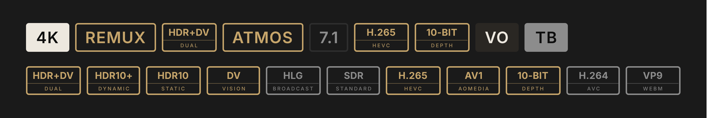
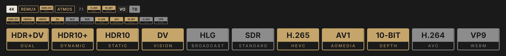

# aiostreams-badges

Version badges for the AIOStreams app. Gold = optimal, grey = acceptable.
Codec and dynamic range are image badges (two lines: name over detail).
Everything else stays as native text badges.

Open index.html for a visual overview with copy buttons.

## Versions

    V1  gold text on transparent, thin rule across the box   badges.json
    V2  gold top block with cut-out text, bottom as V1        badges-v2.json

Both use the same badges.css (one height and one corner radius for all
badges, image fills the app frame).

## Files

    index.html          overview page: preview, install, copy buttons
    badges.json         full badge set, V1 images (47 badges)
    badges-v2.json      full badge set, V2 images
    quick-filters.json  quick filter row (T1, 4K, HD, SD, HDR, SDR, IMAX, Extended, VF)
    badges.css          custom CSS, required for the image badges
    codec/  hdr/        V1 images, PNG 6x + SVG
    v2/codec/  v2/hdr/  V2 images, PNG 6x + SVG

    gold  codec: h265 av1 10bit    hdr: hdrdv dv hdr10plus hdr10
    grey  codec: h264 vp9          hdr: hlg sdr

## Install

1. Badges: Settings > Playback > Versions > Badges > Edit.
   Delete all existing badges (same label = first one wins), paste
   badges.json (V1) or badges-v2.json (V2) in Import, click Import, then Save.
   The row should read "47 badges of your own".
2. CSS: Settings > Theme > Custom CSS. Paste badges.css at the end,
   Apply CSS, then Keep within 15 s. Without it the images render small
   and sit low.
3. Quick filters: Settings > Playback > Versions > Quick filters > Edit.
   Delete existing filters, paste quick-filters.json in Import, Save.
4. Quit and relaunch the app (Cmd+Q) so images reload.

Image URLs carry ?v=N. Bump N after replacing an image: GitHub raw and the
app both cache.

## Dependencies

Some badges read results from the AIOStreams config, not from the file name.

    T1 T2 T3 LQ      Vidhin ranked stream expressions (rseMatched)
                     https://raw.githubusercontent.com/Vidhin05/Releases-Regex/main/English/expressions.json
    RD TB AD EN      four ranked stream expressions, score 0:
                     /* Ready RD */ service(cached(streams), 'realdebrid')
                     /* Ready AD */ service(cached(streams), 'alldebrid')
                     /* Ready TB */ service(cached(streams), 'torbox')
                     /* Ready EN */ service(cached(streams), 'easynews')
    SDR filter       formatter writes "SDR" when a stream has no visual tag

Remove the badges you do not need before importing.

## Design

Typeface Inter. Image 81 x 41 units: top 15 pt bold, bottom 8 pt medium
tracked 1.8, rule 0.75 at 55 % on the boundary. V2 fills the top
block with the tier colour and cuts the top text out. The app border (1 px,
gold #C6A56B or grey #8C8C8C) frames it; badge padding is 0 via CSS.
CSS sets every badge to 1.375rem high with a 5 px radius.
Palette: black #0E0E0E, ivory #EDE8DF, gold #C6A56B, greys #8C8C8C
#5A5A5A #4A4A4A #2E2E2E, FR fill #2A2723 / #1C1B19.
