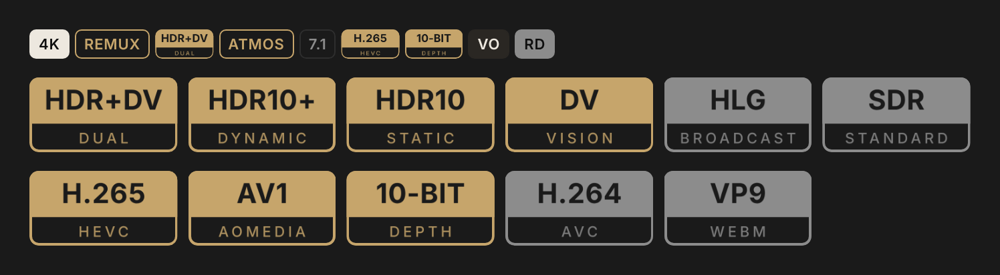

# aiostreams-badges

Version badges for the AIOStreams app. Gold = optimal, grey = acceptable.
Codec and dynamic range are two-line image badges: a filled top block with
the name cut out, the detail below a full-width rule. Everything else stays
as native text badges.

Step by step guide: [INSTALL.md](INSTALL.md).
Open index.html for a visual overview with copy buttons.

## Files

    INSTALL.md          step by step install, checks, troubleshooting
    index.html          overview page: preview, install, copy buttons
    badges.json         full badge set (70 badges)
    badges.css          custom CSS, required for the image badges
    quick-filters.json  quick filter row (T1, 4K, HD, SD, HDR, SDR, IMAX, Extended, VF)
    formatter/          name.txt (official title), name-alt.txt (file title),
                        description.txt
    codec/  hdr/        images, PNG 6x + SVG
    preview-badges.png  preview

    gold  codec: h265 av1 10bit    hdr: hdrdv dv hdr10plus hdr10
    grey  codec: h264 vp9          hdr: hlg sdr

## Install

1. Badges: Settings > Playback > Versions > Badges > Edit.
   Delete all existing badges (same label = first one wins), paste
   badges.json in Import, click Import, then Save.
   The row should read "70 badges of your own".
2. CSS: Settings > Theme > Custom CSS. Paste badges.css at the end,
   Apply CSS, then Keep within 15 s. It gives text and image badges the
   same height and corner radius and makes the image fill the frame.
3. Quick filters: Settings > Playback > Versions > Quick filters > Edit.
   Delete existing filters, paste quick-filters.json in Import, Save.
4. Formatter (optional): AIOStreams config > Formatter > Custom. Paste
   formatter/name.txt in Name Template and formatter/description.txt in
   Description Template, save.
5. Quit and relaunch the app (Cmd+Q) so images reload.

The CSS cannot live inside badges.json: the badge format has no CSS field.

Image URLs carry ?v=N. Bump N after replacing an image: GitHub raw and the
app both cache.

## Dependencies

SDR (badge and quick filter) is detected from the file name: no HDR, DV,
DoVi, HLG or Dolby Vision marker. No formatter text needed.

Some badges read results from the AIOStreams config, not from the file name.

    T1 T2 T3 LQ      Vidhin ranked stream expressions (rseMatched)
                     https://raw.githubusercontent.com/Vidhin05/Releases-Regex/main/English/expressions.json
    RD TB AD EN      four ranked stream expressions, score 0:
                     /* Ready RD */ service(cached(streams), 'realdebrid')
                     /* Ready AD */ service(cached(streams), 'alldebrid')
                     /* Ready TB */ service(cached(streams), 'torbox')
                     /* Ready EN */ service(cached(streams), 'easynews')

Remove the badges you do not need before importing.

## Design

Typeface Inter. Image 81 x 41 units, no frame: top block filled with the
tier colour, name cut out (Inter Bold 15); detail below (Inter Medium 8,
tracked 1.8, 85 %). The app border (1 px, gold #C6A56B or grey #8C8C8C)
frames it. CSS: every badge 1.375rem high, 5 px radius; image badges with
padding 0, the image 1 px under the frame, badge clipped to its shape. Palette: black #0E0E0E, ivory #EDE8DF, gold #C6A56B, greys
#8C8C8C #5A5A5A #4A4A4A #2E2E2E, FR fill #2A2723 / #1C1B19.
